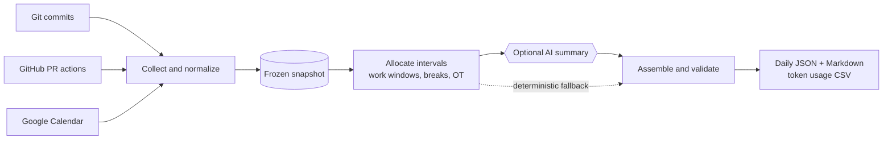

# Personal Timesheet Logger

**Evidence-based daily timesheets from your Git commits, GitHub pull requests and Google Calendar.**


Personal Timesheet Logger builds a **reviewable proposal** of your working day from
real activity: commits, PRs you opened, reviewed or merged, and your Calendar.
Python owns every deterministic step (collection, normalization, interval math,
matching, validation and storage). AI is optional and only writes short
descriptions; it never changes times or durations.

> [!IMPORTANT]
> Output is a proposal, not a measurement. Development time is *estimated* from
> commit boundaries, and Calendar rows are marked **attendance unconfirmed** until
> you confirm them. Nothing is published anywhere unless you explicitly ask.

---

## Contents

- [Features](#features)
- [How it works](#how-it-works)
- [Requirements](#requirements)
- [Quick start](#quick-start)
- [Usage](#usage)
- [Example output](#example-output)
- [Configuration](#configuration)
- [Project structure](#project-structure)
- [Documentation](#documentation)
- [Testing](#testing)
- [Security and privacy](#security-and-privacy)
- [Limitations](#limitations)

## Features

- **Real sources only.** GitHub commits, PR actions and submitted reviews, local
  `git log --all`, and Google Calendar. A failed source is never replaced by sample
  data; the run produces an `INCOMPLETE` draft instead.
- **Commit-interval allocation.** Time between a confirmed start and successive
  commits becomes development blocks, with breaks and meetings subtracted.
- **Work windows and overtime.** A morning start (e.g. `09:00`) expands to
  `09:00–12:00` and `13:30–18:30`; commits outside those windows become estimated OT.
- **Frozen, reproducible runs.** `prepare` writes an immutable snapshot with a
  SHA-256 fingerprint; `assemble` rebuilds from it without re-collecting.
- **Optional AI summaries.** A compact, size-bounded request (12 KB by default) with
  validated output and a deterministic fallback when AI is skipped or invalid.
- **Measured token usage.** Exact usage for Codex and Claude runs is recorded to CSV;
  missing usage stays *unknown* and is never counted as zero.
- **Safe storage.** Atomic writes, POSIX locks and a recovery journal protect your
  existing timesheets. Manual and override rows are preserved across reruns.
- **Agent integrations.** Ships as a Claude Code skill and as Codex CLI skills.

## How it works



| Phase | What happens | Calls AI |
| --- | --- | :---: |
| `prepare` | Collects every source and writes an immutable snapshot plus the compact AI input | No |
| `summary` | Optionally sends the compact request (Codex runner or Claude) and records exact token usage | Yes |
| `assemble` | Validates AI output against the snapshot and writes the final timesheet | No |

The default `--phase run` performs a single pass with deterministic descriptions.
See [Pipeline phases](docs/pipeline.md) for details.

## Requirements

- Python **3.11+** on macOS or Linux (POSIX file locks are required)
- Git
- GitHub access through `GH_TOKEN`/`GITHUB_TOKEN`, an authenticated `gh` CLI, or an
  opted-in Git credential helper
- For live Calendar: a Google Cloud project with the Calendar API enabled and a
  Desktop OAuth client
- Optional: [Codex CLI](docs/codex-usage.md) or Claude Code for AI summaries

The core scripts use only the standard library. Validation was run on Python 3.14;
the 3.11 minimum has not been separately executed.

## Quick start

**1. Create the environment**

```bash
python3 -m venv .venv
.venv/bin/python -m pip install -r requirements-calendar.txt
source .venv/bin/activate
```

**2. Create your profile**

```bash
cp config/example-config.json config/user-config.json
```

Set your names, emails, GitHub logins, repositories and IANA timezone. The file is
git-ignored. See [Configuration](docs/configuration.md).

**3. Authorize Google Calendar (read-only)**

Place your `credentials.json` in the repository root (or configure its path), then:

```bash
python3 scripts/setup_calendar_oauth.py --config config/user-config.json
python3 scripts/get_calendar_activity.py --config config/user-config.json --date 2026-10-07
```

**4. Generate a timesheet**

```bash
python3 scripts/run_pipeline.py --config config/user-config.json \
  --date 2026-10-07 --work-day-start 09:00
```

Output is written to `data/timesheets/` as `<date>.json` and `<date>.md`.

> [!TIP]
> To try it without any accounts, `python3 scripts/build_demo.py` regenerates a fully
> synthetic demo in [`examples/synthetic/`](examples/synthetic/).

## Usage

### From Codex CLI

```bash
./bin/personal-timesheet-codex --check                  # verify login, GitHub and Calendar setup
./bin/personal-timesheet-codex 09:00                     # today's preview, 09:00 start
./bin/personal-timesheet-codex "8:00-12:00, 1h30-4:00"   # explicit work windows
```

Inside a Codex session opened in this repository:

```text
$personal-timesheet 09:00
$personal-timesheet-windows 8:00-12:00, 1h30-4:00
$personal-timesheet-confirmed 9:00, OT confirmed, attendance confirmed
```

See [Codex launcher and skills](docs/codex-skills.md) for behavior, defaults and the
launcher's sandbox settings.

### From Claude Code

```bash
python3 scripts/install_skill.py --scope project    # this repository only
python3 scripts/install_skill.py --scope personal   # all projects
```

Then ask Claude Code to *"log today's work"* or *"log my work for 2026-10-07"*. The
installer symlinks the bundle and never copies credentials.

### Step by step

[`bin/timesheet-steps`](docs/workflow-steps.md) runs each phase separately and shows
its output: sources, blocks, the exact AI request, summary, usage and final Markdown.

```bash
TS_RUN="data/audit/steps-$(date +%Y%m%d-%H%M%S)"
./bin/timesheet-steps prepare "$TS_RUN" --date 2026-10-09 --start 09:00
./bin/timesheet-steps show "$TS_RUN" blocks
```

## Example output

From the synthetic demo in [`examples/synthetic/2026-10-07.md`](examples/synthetic/2026-10-07.md):

| Time | Duration | Description | Evidence / Sources |
| :--- | :---: | :--- | :--- |
| 09:00 – 09:30 | 30m (scheduled) | Synthetic meeting A. PRs: None | Cal: Synthetic meeting A |
| 09:30 – 10:00 | 30m (scheduled) — attendance review required | Calendar overlap — attendance confirmation required | Cal: Synthetic meeting A, Synthetic meeting B |
| 10:00 – 10:30 | 30m (scheduled) | Synthetic meeting B. PRs: None | Cal: Synthetic meeting B |
| 10:30 – 12:00 | 90m (estimated) | [DEMO-1] Demo-1 fix validation. PRs: None | 1 commit |

**Total Proposed Time:** 180 mins (3h 00m)

### Allocation at a glance

With a 09:00 start, commits at 10:10, 11:40, 14:10 and 16:00, and no meetings:

| Block | Duration |
| --- | ---: |
| 09:00 – 10:10 | 70m |
| 10:10 – 11:40 | 90m |
| 11:40 – 12:00 | 20m |
| *12:00 – 13:30 lunch break* | — |
| 13:30 – 14:10 | 40m |
| 14:10 – 16:00 | 110m |
| **Total proposed** | **330m** |

Adjacent commits that resolve to the same pull request are merged into one row. The
full rules are in [Evidence and allocation policy](docs/evidence-policy.md).

## Configuration

Settings resolve in the order **CLI flag > environment variable > profile > default**.
The most common ones:

| Setting | CLI | Environment | Profile key |
| --- | --- | --- | --- |
| Repositories | `--repos` | `TIMESHEET_REPOS` | `repositories` |
| Calendar token | `--calendar-token` | `GOOGLE_CALENDAR_TOKEN` | `calendar.token_path` |
| Timezone | `--timezone` | — | `timezone` |
| Work schedule | `--work-day-start`, `--work-windows` | — | `work_schedule` |

Full reference: [Configuration](docs/configuration.md) · [Work schedule](docs/work-schedule.md)

## Project structure

```text
.
├── bin/                  # Codex launcher and step-by-step runner
├── config/               # Example profiles (your user-config.json stays local)
├── docs/                 # Guides, policies and validation reports
├── examples/synthetic/   # Fully synthetic demo output
├── scripts/              # Collection, allocation, AI payload, storage, CLI entry points
├── tests/                # unittest suite
├── .codex/skills/        # Codex CLI skills
├── SKILL.md              # Claude Code skill definition
└── workflow.md           # Policies and token budget used by the skills
```

## Documentation

| Guide | Description |
| --- | --- |
| [Configuration](docs/configuration.md) | Profile, GitHub auth, Calendar OAuth, path precedence |
| [Pipeline phases](docs/pipeline.md) | `prepare`, `summary` and `assemble` in detail |
| [Step-by-step runner](docs/workflow-steps.md) | Inspect every stage with `bin/timesheet-steps` |
| [Evidence and allocation policy](docs/evidence-policy.md) | Completeness, Calendar, commit intervals, storage |
| [Work schedule](docs/work-schedule.md) | Daily windows, breaks, overtime |
| [AI payload and token usage](docs/token-usage.md) | Compact request, size guard, usage recording |
| [Codex launcher and skills](docs/codex-skills.md) | `$personal-timesheet` commands and launcher |
| [Codex usage](docs/codex-usage.md) | Standalone Codex CLI setup and measured runs |
| [Company machine run](docs/company-machine-run.md) | End-to-end audit on a work machine (Vietnamese) |
| [Data provenance](data/README.md) | Historical tracked examples |

Validation reports for individual features are also kept in [`docs/`](docs/).

## Testing

```bash
python3 -m unittest discover -s tests
```

Tests are synthetic and never touch live accounts. Real-source audits are documented
separately in `docs/`.

## Security and privacy

- Never commit `credentials.json`, `token.json`, `.env` or `config/user-config.json`;
  all are git-ignored.
- Calendar access is **read-only**. The OAuth bootstrap refuses to replace an existing
  token unless `--replace` is passed.
- The Codex launcher runs with `danger-full-access` so it can read the host GitHub
  credential store. Use it only in a trusted checkout and review the commands Codex
  proposes.
- Publishing to an external timesheet system happens only on an explicit request.

## Limitations

- Supported sources are GitHub and Google Calendar. GitLab and ICS adapters are not
  implemented.
- Remote collection scans the default branch only; local collection scans all refs.
- Development durations assume continuous work between commits. They are estimates.
- Live Claude Code transcript compatibility still needs acceptance on an installed
  environment. No token savings are claimed without measured evidence.
